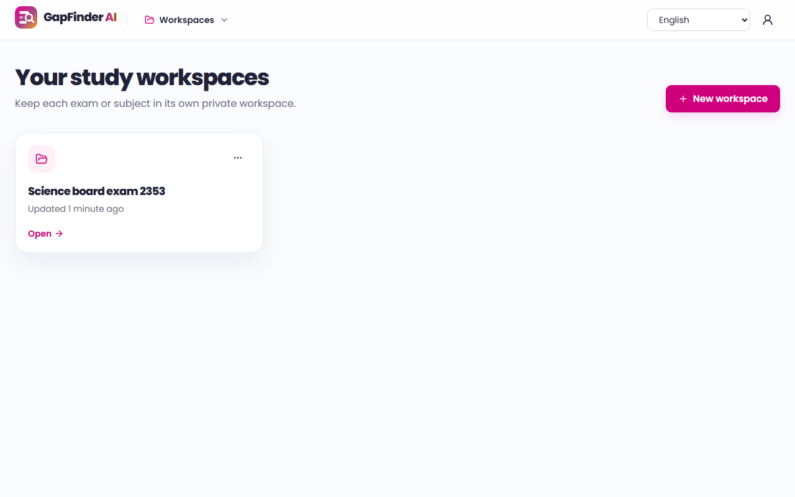
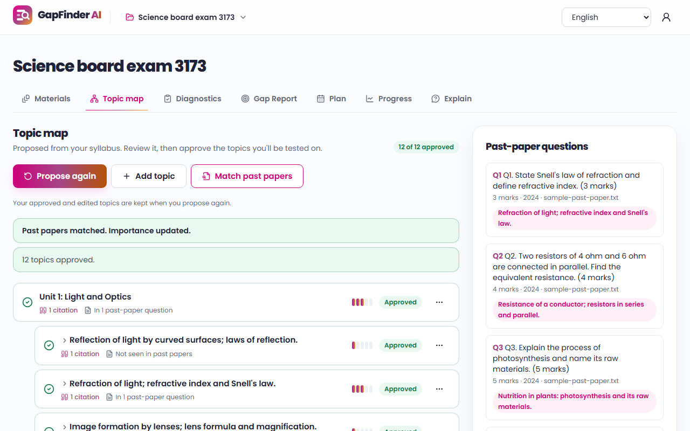
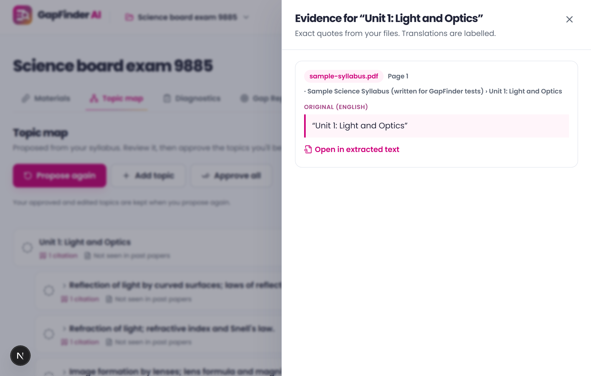
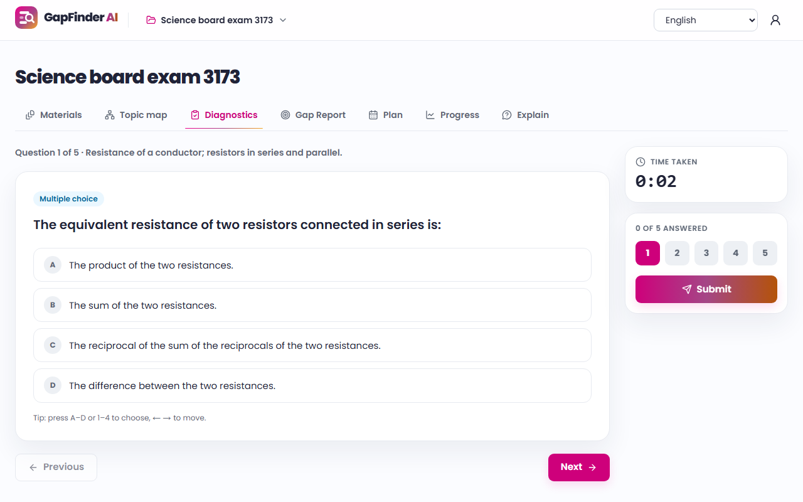
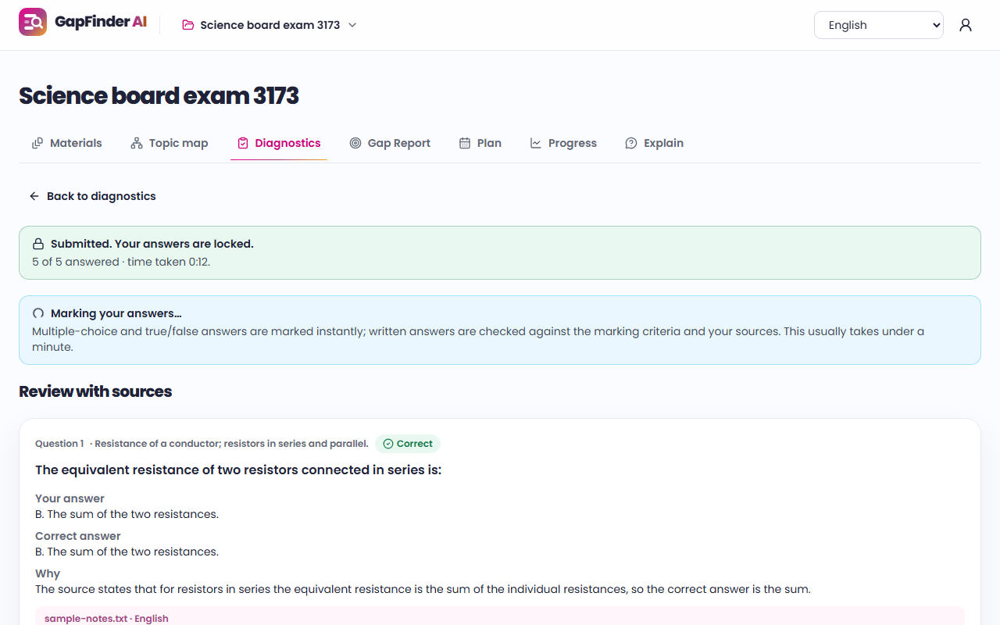
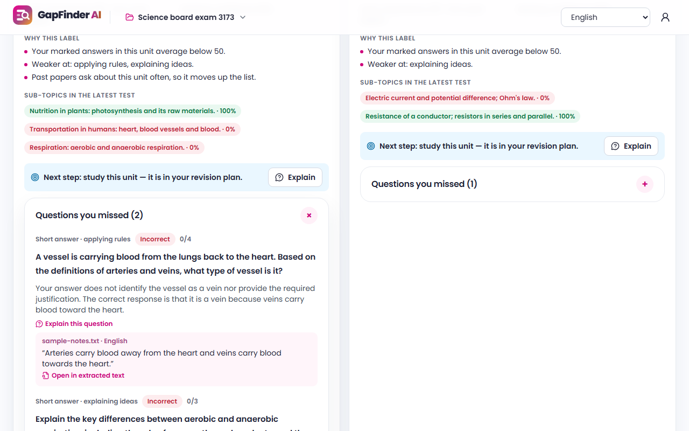
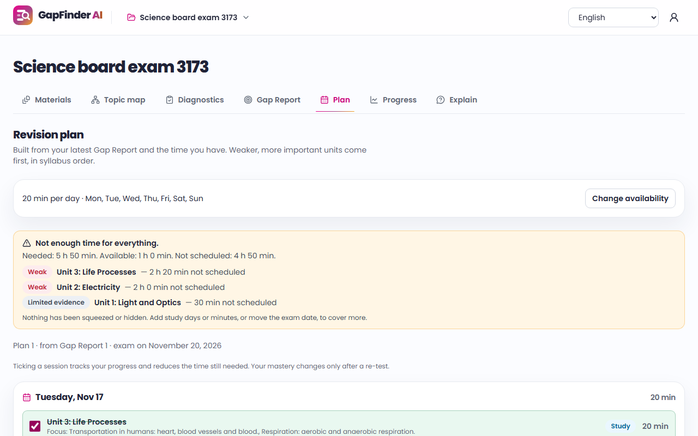
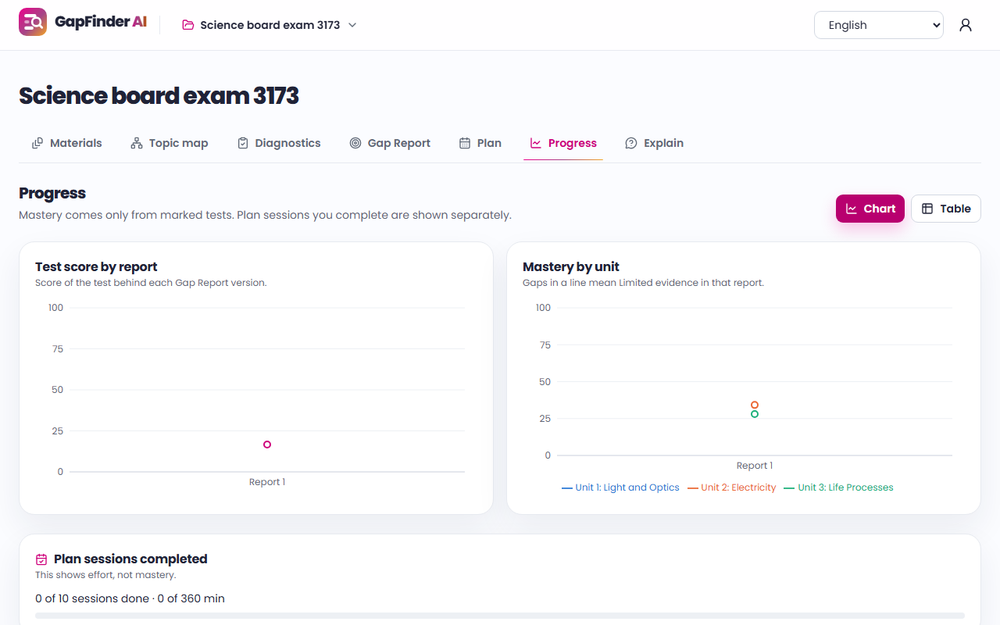
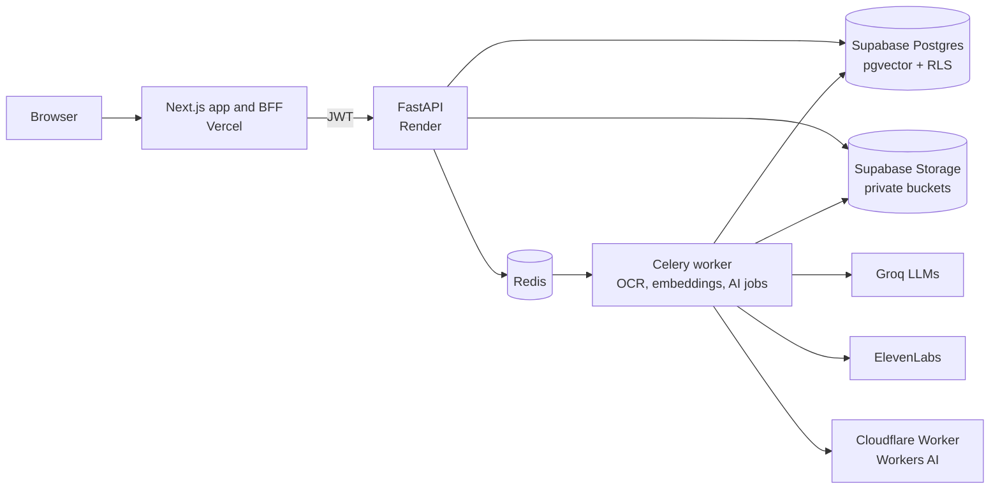

<p align="center">
  
</p>

<h1 align="center">GapFinder AI</h1>

<p align="center">
  <strong>Find what a student does not know yet, prove it from their own material, and plan what to do about it.</strong>
</p>

<p align="center">
  Source-cited diagnostic learning for school students, in five languages.
</p>

<br>

<table align="center">
  <tr>
    <td align="right"><sub><strong>FRONTEND</strong></sub></td>
    <td>
      
      
      
      
      
    </td>
  </tr>
  <tr>
    <td align="right"><sub><strong>BACKEND</strong></sub></td>
    <td>
      
      
      
      
      
    </td>
  </tr>
  <tr>
    <td align="right"><sub><strong>DATA</strong></sub></td>
    <td>
      
      
    </td>
  </tr>
  <tr>
    <td align="right"><sub><strong>AI</strong></sub></td>
    <td>
      
      
      
      
    </td>
  </tr>
  <tr>
    <td align="right"><sub><strong>DELIVERY</strong></sub></td>
    <td>
      
      
      
      
      
    </td>
  </tr>
</table>

<p align="center">
  <a href="#the-problem">The problem</a> &nbsp;&middot;&nbsp;
  <a href="#how-it-works">How it works</a> &nbsp;&middot;&nbsp;
  <a href="#product-tour">Product tour</a> &nbsp;&middot;&nbsp;
  <a href="#features">Features</a> &nbsp;&middot;&nbsp;
  <a href="#the-scoring-model">Scoring model</a> &nbsp;&middot;&nbsp;
  <a href="#architecture">Architecture</a> &nbsp;&middot;&nbsp;
  <a href="#getting-started">Getting started</a>
</p>

---

## The problem

Most study apps answer the question a student asks. The harder problem is the question they do not
know to ask: *which parts of my syllabus am I actually weak in, and how sure can I be?*

Generic AI tutors make this worse. They quiz from the open internet rather than the student's own
syllabus, invent marks and confidence, and rarely admit when there is not enough evidence to say
anything at all.

**GapFinder AI takes the opposite approach.** It works only from the material the student uploads,
cites the exact passage behind every topic, question and explanation, and keeps every score, label
and schedule in deterministic, versioned code that a reviewer can read and test. Language models
draft; rules decide.

## How it works

<table>
  <tr>
    <td width="64" align="center"></td>
    <td><strong>1. Upload</strong><br>Add a syllabus, notes, textbook chapters and past papers to a private workspace. TXT, DOCX and PDF, including scanned pages through OCR.</td>
  </tr>
  <tr>
    <td align="center"></td>
    <td><strong>2. Map</strong><br>GapFinder proposes a topic map from the syllabus. Every unit cites the passage it came from; the student edits, nests and approves it.</td>
  </tr>
  <tr>
    <td align="center"></td>
    <td><strong>3. Weigh</strong><br>Past-paper questions are split out with their marks and years, matched to topics, and used to compute exam importance from 1 to 5.</td>
  </tr>
  <tr>
    <td align="center"></td>
    <td><strong>4. Diagnose</strong><br>A 5, 10 or 15 question diagnostic is written only from the student's material. Each question carries the exact quote that supports it.</td>
  </tr>
  <tr>
    <td align="center"></td>
    <td><strong>5. Report</strong><br>A versioned Gap Report labels each unit Weak, Medium, Strong or Limited evidence, and shows the reasons and missed questions behind every label.</td>
  </tr>
  <tr>
    <td align="center"></td>
    <td><strong>6. Plan</strong><br>The report becomes a revision plan that fits the days and minutes the student actually has, and states any shortfall honestly.</td>
  </tr>
  <tr>
    <td align="center"></td>
    <td><strong>7. Improve</strong><br>Re-tests update mastery over time, while the Explain helper answers follow-up questions with citations, voice and illustrations.</td>
  </tr>
</table>

## Product tour

<table>
  <tr>
    <td width="50%"><br><sub><strong>Dashboard</strong> &middot; every workspace, its materials and the next recommended step</sub></td>
    <td width="50%"><br><sub><strong>Topic map</strong> &middot; syllabus units with citations and exam importance</sub></td>
  </tr>
  <tr>
    <td><br><sub><strong>Evidence</strong> &middot; the exact passage behind a topic or question</sub></td>
    <td><br><sub><strong>Diagnostic</strong> &middot; timed or untimed, autosaved, keyboard friendly</sub></td>
  </tr>
  <tr>
    <td><br><sub><strong>Review</strong> &middot; marked answers with rubric reasoning and sources</sub></td>
    <td><br><sub><strong>Gap Report</strong> &middot; mastery, labels and reasons for every unit</sub></td>
  </tr>
  <tr>
    <td><br><sub><strong>Revision plan</strong> &middot; prioritised sessions up to the exam date</sub></td>
    <td><br><sub><strong>Progress</strong> &middot; mastery across re-tests over time</sub></td>
  </tr>
</table>

## Features

<table>
  <tr>
    <td width="50%" valign="top">
       &nbsp;<strong>Materials pipeline</strong><br>
      <sub>Resumable private uploads with checksum verification. PDF, DOCX and TXT extraction, OCR for scanned PDFs in English, Hindi, Punjabi and Telugu, and page- and heading-aware chunking.</sub>
    </td>
    <td width="50%" valign="top">
       &nbsp;<strong>Cited topic map</strong><br>
      <sub>Units and subtopics proposed from the syllabus with exact citations. The student can rename, nest, reorder, approve and override importance.</sub>
    </td>
  </tr>
  <tr>
    <td valign="top">
       &nbsp;<strong>Past-paper weighting</strong><br>
      <sub>Questions segmented with marks and years, mapped to topics, and used only to weight importance. A student override always wins.</sub>
    </td>
    <td valign="top">
       &nbsp;<strong>Grounded diagnostics</strong><br>
      <sub>MCQ, true or false and short-answer questions across recall, understand and apply levels. Server-side deadlines, autosave, and an answer key that stays hidden until submission.</sub>
    </td>
  </tr>
  <tr>
    <td valign="top">
       &nbsp;<strong>Evidence-bound marking</strong><br>
      <sub>Objective questions are marked by fixed rules. Written answers are marked against a hidden rubric and the cited sources; on failure, no score is invented.</sub>
    </td>
    <td valign="top">
       &nbsp;<strong>Versioned Gap Reports</strong><br>
      <sub>Published thresholds, recency-weighted mastery, limited-evidence detection and immutable versions, so the student can compare reports over time.</sub>
    </td>
  </tr>
  <tr>
    <td valign="top">
       &nbsp;<strong>Honest revision plans</strong><br>
      <sub>Priority- and prerequisite-aware sessions of at most 45 minutes on the student's chosen weekdays, a final re-test, and an explicit shortfall when time runs out.</sub>
    </td>
    <td valign="top">
       &nbsp;<strong>Explain helper</strong><br>
      <sub>Answers follow-up questions from the workspace with citations, and declines when the material does not support an answer.</sub>
    </td>
  </tr>
  <tr>
    <td valign="top">
       &nbsp;<strong>Voice and illustrations</strong><br>
      <sub>Speech input and read-aloud through ElevenLabs. Figures from the student's own sources are preferred over generated illustrations.</sub>
    </td>
    <td valign="top">
       &nbsp;<strong>Five interface languages</strong><br>
      <sub>English, Hindi, Punjabi, Telugu and Dakhni (Latin script). Source quotes always appear in their original language, with labelled translations.</sub>
    </td>
  </tr>
  <tr>
    <td valign="top">
       &nbsp;<strong>Privacy by construction</strong><br>
      <sub>Workspace isolation enforced in the API and again by Postgres row-level security. Workspaces and accounts can be deleted immediately.</sub>
    </td>
    <td valign="top">
       &nbsp;<strong>Ready-made demo</strong><br>
      <sub>Original sample Class 10 Science material, copied privately into the user's own account so the full flow can be tried in minutes.</sub>
    </td>
  </tr>
  <tr>
    <td colspan="2" valign="top">
       &nbsp;<strong>Transparent fair use</strong><br>
      <sub>Clear daily limits per student: 10 diagnostics, 20 explanations, 10 voice requests and 10 illustrations.</sub>
    </td>
  </tr>
</table>

## Design principles

<table>
  <tr>
    <td width="33%" valign="top" align="center">
      <br>
      <strong>Cite everything</strong><br>
      <sub>Every topic, question, mark and explanation points back to an exact passage in the student's own material.</sub>
    </td>
    <td width="33%" valign="top" align="center">
      <br>
      <strong>Models draft, rules decide</strong><br>
      <sub>Scores, labels, importance and schedules come from pure, versioned, unit-tested functions, never from a language model.</sub>
    </td>
    <td width="33%" valign="top" align="center">
      <br>
      <strong>Say when it is unsure</strong><br>
      <sub>Thin evidence is labelled Limited evidence, unsupported questions are declined, and missing time is reported as a shortfall.</sub>
    </td>
  </tr>
</table>

## The scoring model

All diagnosis and planning logic lives in `api/app/services/*_policy.py` as pure functions with a
policy version stamped on every result.

**Mastery** for each unit, from 0 to 100:

```
mastery = 100 x ( 0.60 x weighted_accuracy      every attempt, older attempts decay by half,
                                                 apply > understand > recall in weight
                + 0.20 x recency_accuracy        the latest attempt only
                + 0.10 x cognitive_coverage      share of the three levels tested
                + 0.10 x evaluation_confidence ) mean grader confidence (objective = 1)
```

| Label | Rule |
|---|---|
| Weak | mastery below 50 |
| Medium | mastery from 50 to below 75 |
| Strong | mastery 75 and above |
| Limited evidence | fewer than 2 evaluated questions, or grader confidence below 0.6 (takes precedence) |

**Exam importance** is `1 + round(4 x weight / max_weight)`, where a topic's weight is the sum of
marks of the past-paper questions mapped to it. With no past papers, every topic is neutral (3).

**Priority** is `(100 - mastery) x (importance / 3) x (0.5 + 0.5 x confidence)`, so weaker, more
examined and more certain gaps come first.

**Revision demand** per unit is a base budget by label (Weak 120, Medium 60, Limited evidence 45,
Strong 20 minutes) scaled by importance, spread round-robin across the available days in sessions of
10 to 45 minutes.

## Architecture



- **Backend-for-frontend.** The browser talks only to the Next.js server, which forwards an explicit allowlist of routes with strictly validated bodies.
- **Defence in depth.** FastAPI verifies the Supabase JWT on every request and scopes every query to the student and workspace; Postgres row-level security repeats the guard.
- **Durable jobs.** Extraction, embeddings, topic proposal, quiz generation, evaluation, explanations, audio and images run as background jobs with user-visible state in Postgres. On hosts without a separate worker, the same tasks run on an in-process thread pool that recovers stale jobs after a restart.
- **Hybrid retrieval.** Evidence is found by combining pgvector similarity over Qwen3 embeddings with Postgres full-text search, always scoped to one workspace.
- **Signed edge calls.** Embeddings and illustrations go through a Cloudflare Worker that only accepts signed requests.

## Technology

| Layer | Technologies |
|---|---|
| Web | Next.js 16 (App Router), React 19, TypeScript, Tailwind CSS 4, Radix primitives, TanStack Query, Framer Motion, next-intl, Recharts, Zod, tus-js-client |
| API | Python 3.12, FastAPI, Pydantic 2, SQLAlchemy 2, Alembic, psycopg 3 |
| Worker | Celery, Redis, PyMuPDF, python-docx, OCRmyPDF and Tesseract |
| Embeddings | Qwen3-Embedding-0.6B (Apache-2.0) on Cloudflare Workers AI, 384 dimensions |
| Data | Supabase Postgres with pgvector, Supabase Auth, Supabase Storage (private buckets) |
| AI services | Groq (gpt-oss-20b and gpt-oss-120b), ElevenLabs (eleven_v3, scribe_v2), Cloudflare Workers AI (FLUX.1 schnell) |
| Delivery | Docker, Docker Compose, Vercel, Render, Cloudflare Workers, GitHub Actions, gitleaks |
| Quality | pytest, mypy (strict), Ruff, Vitest, Playwright, axe-core, Node test runner |

## Repository structure

```
api/        FastAPI application, Alembic migrations, policies, services, tests, evals, demo material
worker/     Celery tasks: extraction, OCR, embeddings, AI jobs
web/        Next.js application, BFF, message catalogs, Playwright and Vitest suites
infra/      Local Docker Compose, Render deploy files, Cloudflare image Worker
docs/       Brand assets used by this README
```

## Getting started

**Prerequisites:** Docker, Node.js 24 with pnpm, Python 3.12, a Supabase project, a Groq API key and
the Cloudflare Worker in `infra/cloudflare-image-worker` (required for embeddings). ElevenLabs is
optional; voice features stay off when it is not configured.

```bash
cp .env.example .env                                  # fill in Supabase, Groq and optional providers
python -m venv .venv && .venv/Scripts/pip install -e "./api[dev]" -e ./worker
cd api && ../.venv/Scripts/python -m alembic upgrade head && cd ..
cd infra && make local-up && cd ..                    # Postgres (tests), Redis, Celery worker
cd api && ../.venv/Scripts/python -m uvicorn app.main:app --port 8000
pnpm install && pnpm --dir web dev                    # http://localhost:3000
```

### Deployment

| Component | Target |
|---|---|
| Web | Vercel (`web/`) |
| API | Render Blueprint (`render.yaml`, Docker, health check at `/health/live`) |
| Queue and counters | Render Key Value |
| Database, auth, storage | Supabase |
| Embeddings and illustrations | Cloudflare Worker (`infra/cloudflare-image-worker`) |

## Quality gates

Lint, type checks, unit tests, builds, migrations and the Worker tests run in GitHub Actions on every push and pull request.

| Area | Command |
|---|---|
| Web | `pnpm web:lint`, `pnpm web:typecheck`, `pnpm web:unit-test`, `pnpm web:build`, `pnpm web:e2e-test` |
| Accessibility | `pnpm web:a11y-test` (axe-core through Playwright) |
| API | `ruff check`, `mypy app`, `pytest`, `alembic check` (run in `api/`) |
| Worker | `pytest` (run in `worker/`) |
| Quiz generation eval | `python -m evals.quiz_eval <notes> <report>` (in the worker image; passes at 30 or more source-verified questions) |
| Image Worker | `pnpm infra:image-worker-test` |
| Secrets | `pnpm quality:scan-secrets` |

---

<p align="center">
  
</p>

<p align="center">
  <strong>Built by Prabhasees Singh</strong>
</p>
